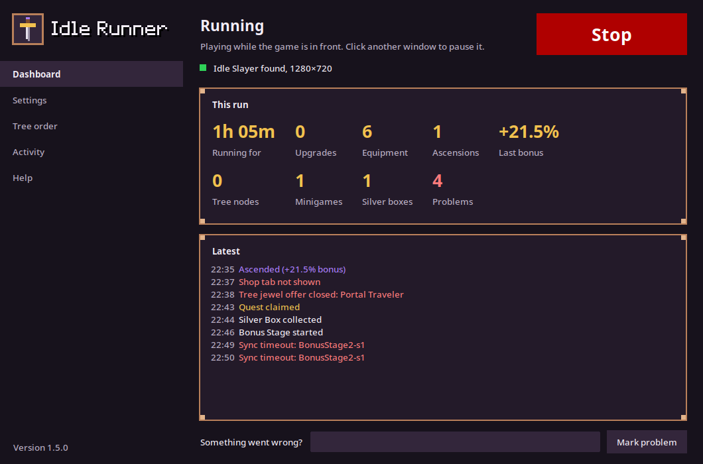
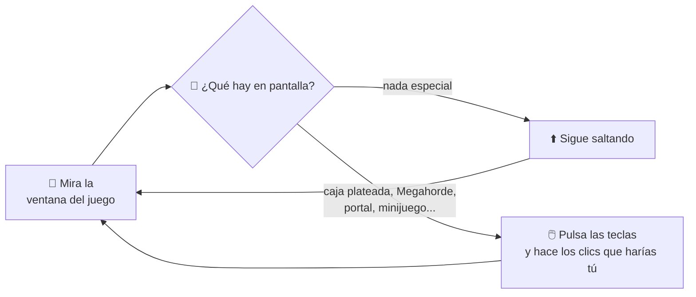
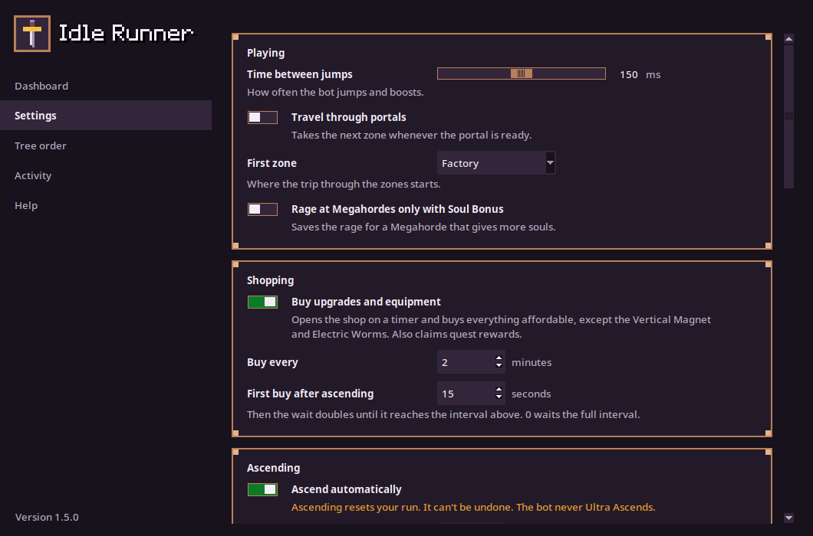
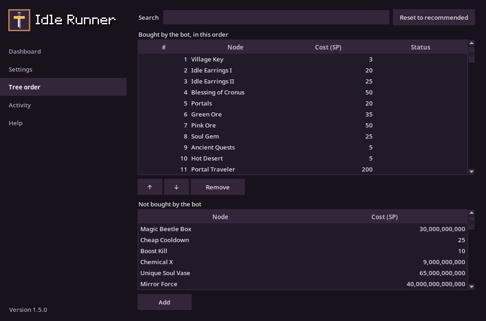

<p align="center">
  
</p>

<p align="center">
  <a href="LICENSE"></a>
  
  
</p>

<p align="center"><a href="README.md">English</a> | <b>Español</b></p>

# Idle Runner

**Un bot de Idle Slayer para Linux y Windows.** Juega [Idle Slayer](https://store.steampowered.com/app/1353300/Idle_Slayer/) por ti. Salta, recoge cajas, compra upgrades, juega los minijuegos, asciende cuando conviene y gasta tus Slayer Points en el Ascension Tree.

Solo **mira la ventana del juego y pulsa teclas**, igual que lo harías tú. Nunca toca la memoria, los archivos ni las partidas guardadas del juego.

**[⬇️ Descargar para Linux o Windows](https://santiguti.github.io/idle-slayer-bot/es/)** (o baja los archivos desde [Releases](../../releases))

> [!NOTE]
> La ventana de Idle Runner todavía está en inglés, y el juego tiene que estar en inglés para que el bot lo lea. Por eso esta página nombra los botones y las opciones como aparecen en inglés.

<p align="center">
  
</p>

<p align="center">
  
  
</p>

## ✨ Qué hace

| | |
|---|---|
| 🏃 **Corre** | Salta y usa el boost sin parar, al ritmo que elijas. |
| 🎁 **Recoge** | Las cajas plateadas y naranjas, y dos Daily Quests extra cada día. Envía a tus minions a sus misiones. |
| 🛒 **Compra** | Upgrades y equipamiento cada pocos minutos, y cobra las recompensas de las quests. Justo después de ascender compra en cuanto tienes 6 monedas, y después va espaciando las compras. |
| 🌀 **Viaja** | Entra en los portales y, si quieres, recorre las zonas una tras otra. |
| 😡 **Usa Rage** | En las Megahordes, y si quieres solo con Soul Bonus. |
| 🎮 **Juega los minijuegos** | Chest Hunts, Bonus Stages 2 y 3, Ascending Heights y la pelea contra Victor. |
| ⬆️ **Asciende** | En cuanto el **"+X% CpS bonus"** del botón Ascend llega al 20 %, o cada 30 minutos como máximo. Puedes cambiar los dos valores o desactivarlo. |
| 🌳 **Gasta SP** | Opcional. Compra nodos del Ascension Tree en tu orden, al iniciar y después de cada ascensión. *Nuevo, todavía en prueba.* |

## 🔒 Seguridad

- Solo lee píxeles de la ventana del juego y envía teclas y clics. Nunca lee ni cambia la memoria, los archivos ni el tráfico de red del juego.
- Nunca gasta jewels (cuestan dinero real): en el Ascension Tree pulsa Buy solo cuando el juego muestra que alcanzan los Slayer Points, y cierra cualquier oferta que pida jewels.
- Nunca hace un Ultra Ascend.
- La compra de nodos del árbol está desactivada hasta que la actives. Ascender viene activado (con un +20 % de CpS bonus, o cada 30 minutos como máximo); desactívalo en la página Settings si prefieres ascender tú.

## 📦 Instalación

En Linux necesitas la **versión de Steam de Idle Slayer para Linux**. Para Windows, mira *Windows* más abajo.

**1. Instálalo.** La forma más fácil: descarga `IdleRunner-…-linux-x64.tar.gz` desde [Releases](../../releases), descomprímelo y ejecuta `./install.sh` dentro de la carpeta `IdleRunner`. Eso agrega *Idle Runner* al menú de aplicaciones (no hace falta Python; Ubuntu 22.04 / Fedora 36 o más nuevo).

O, con Python 3.12 o más nuevo y [pipx](https://pipx.pypa.io/):

```bash
pipx install git+https://github.com/santiguti/idle-slayer-bot
idle-runner            # abre la ventana
```

O desde un clon, en un entorno virtual:

```bash
git clone https://github.com/santiguti/idle-slayer-bot.git
cd idle-slayer-bot
python3 -m venv .venv
.venv/bin/pip install -e .
```

**2. Prepara el juego:**
- En ventana, a **1280x720** y en **inglés**.
- Teclas: salto = **flecha arriba**, boost = **flecha derecha**.
- Desactiva el cursor personalizado (*Disable custom cursor* activado), el diálogo del portal (*Confirm dialogue when activating the Portal*) y la notación científica (*Use scientific notation*).
- Activa *Rounded bulk buy* y *Hide locked Quest rewards*.
- No compres el **Vertical Magnet**.

En el primer inicio de cada día el bot abre los Settings del juego, lee estas opciones (solo las lee y después pulsa Cancel) y muestra las que están mal en la página Activity. Cuando todas están bien, no vuelve a mirarlas ese día; **Check game settings now**, en la página Settings, hace que las mire otra vez.

**3. Ábrelo:** `idle-runner` (o `.venv/bin/python -m idle_runner`) abre la ventana.

Pulsa **Start** y haz clic en el juego. El bot solo juega mientras la ventana del juego está activa: cambia a otra ventana para pausarlo y vuelve a hacer clic en el juego para seguir. La ventana muestra:

- **Dashboard:** qué está haciendo el bot, si encontró el juego con el tamaño correcto, los números de esta partida y los últimos eventos.
- **Settings:** cada opción explicada con palabras simples, guardada en cuanto la cambias.
- **Tree order:** qué nodos del Ascension Tree compra el bot y en qué orden. Arrástralos, agrega o quita nodos, o vuelve al orden recomendado.
- **Activity:** todo lo que hizo el bot, filtrado por compras, ascensiones, minijuegos o problemas.
- **Help:** la preparación del juego, lo que el bot nunca hace y enlaces.

<details>
<summary>Windows</summary>

Descarga `IdleRunner-…-windows-x64.zip` desde [Releases](../../releases), descomprímelo donde quieras y haz doble clic en `IdleRunner.exe`. El exe no tiene firma de código, así que SmartScreen puede decir "Windows protegió su PC": elige **Más información → Ejecutar de todas formas**.

O ejecútalo desde el código en PowerShell (Python 3.12 o más nuevo):

```powershell
git clone https://github.com/santiguti/idle-slayer-bot.git
cd idle-slayer-bot
py -m venv .venv
.venv\Scripts\pip install -e .
.venv\Scripts\idle-runner
```

</details>

> [!WARNING]
> **El bot asciende solo desde el principio** (con un +20 % de CpS bonus, o a los 30 minutos), y una ascensión no se puede deshacer: reinicia tu partida. Desactiva *Ascend automatically* en la página Settings si prefieres hacerlo tú. La compra de nodos del árbol, que gasta tus SP, está desactivada hasta que la actives.

<details>
<summary>¿El juego arranca con la pantalla en negro?</summary>

Al runtime de Steam le falta una biblioteca que el juego necesita. En Steam, abre **Propiedades → Opciones de lanzamiento** de Idle Slayer y pega esto (ajusta la ruta a tu biblioteca de Steam):

```
"<steam library>/steamapps/common/Idle Slayer/Idle Slayer.x86_64" # %command%
```

Fíjate también en que el juego use X11/XWayland: `~/.config/unity3d/Pablo Leban/Idle Slayer/Player.log` tiene que decir `Selected window backend: x11`. No lo lances con `-force-wayland`.

</details>

<details>
<summary>¿KDE pide permiso de "control remoto"?</summary>

La primera vez que el bot pulsa una tecla, KDE Plasma en Wayland pregunta si lo permites. Acepta y vuelve a hacer clic en el juego.

</details>

## 🛡️ Hecho para jugar sin supervisión

| | |
|---|---|
| 👀 **Siempre atento** | Busca Megahordes, Chest Hunts, quests y cajas plateadas todo el tiempo, sin puntos ciegos. |
| 🎯 **Fácil de controlar** | Juega mientras el juego está activo. Cambia de ventana para pausarlo y vuelve para seguir. Sin atajos de teclado y sin robar el foco. |
| 🛡️ **Ascensiones seguras** | Nunca hace clic en el botón **Ultra Ascend**: confirma en un lugar seguro, y solo cuando aparece el diálogo "Are you sure?". Nunca hace un Ultra Ascend. |
| ♻️ **Preparado para el Ultra Ascension** | Maneja el juego después de un Ultra Ascension: una tienda sin la pestaña Quests, sin pestaña Minions y con un solo botón Ascend. |
| 🔧 **Nunca se traba** | Una pantalla que no aparece queda registrada con una captura y se saltea. Después de 5 errores seguidos se detiene de forma segura. |
| 📼 **Caja negra** | Guarda la última hora de juego. Pulsa **Mark problem** y ese momento queda guardado para siempre. |
| 📐 **Control de la ventana** | Se pausa con un aviso mientras la ventana no mide 1280x720. |
| 🧪 **Tests automáticos** | Más de 400 tests, muchos con capturas reales del juego. |

<details>
<summary>Todos los detalles</summary>

- Foco = juega, alt-tab = pausa, Ctrl+C = detener. Cerrar la terminal o `kill` también lo detienen limpiamente, y las teclas pulsadas se sueltan (una tecla mantenida se suelta en cuanto el juego pierde el foco).
- El tamaño de la ventana se controla todo el tiempo (por ejemplo, si la ventana se maximiza).
- Un error inesperado queda registrado con su traceback y el bot sigue; se detiene después de 5 errores seguidos. Los bucles que podrían quedarse colgados se rinden después de un tiempo y registran un evento `stuck` con una captura.
- El saltador se pausa en cuanto empieza una rutina de menús.
- Los clics fuera de la ventana del juego se rechazan.
- **Tienda:** cada clic en una pestaña se verifica antes de comprar, así un clic pensado para una pestaña no cae en otra (por ejemplo, "Max" en Equipment es "Buy all available" en Upgrades). Si la tienda no se abre (por ejemplo, porque la pantalla de resultados de un minijuego todavía la tapa), lo vuelve a intentar 15 s después. La tienda se cierra solo mientras se ve, y el bot espera a que termine de cerrarse: un segundo clic mientras se cierra deja un panel vacío que bloquea todos los clics siguientes.
- **Quests:** las filas azules de quests de eventos se saltean mientras su botón es el gris "Quest Reward", y se compran cuando se cobran. Sin la pestaña Quests (después de un Ultra Ascension, hasta que se vuelven a desbloquear) no cobra, así nunca abre por error la tienda de jewels.
- **Random Box:** si aparece una caja plateada o naranja mientras compra o cobra quests, el bot se detiene, deja que el saltador la agarre y vuelve a comprar poco después.
- **Después de ascender:** el bot lee el contador de monedas y compra en cuanto muestra 6 (el primer nivel de la espada), ya sea una ascensión del bot o tuya. Después las compras empiezan a los `post_ascend_first_buy_seconds` (15 s por defecto) y la espera se duplica hasta llegar a `auto_buy_minutes`.
- **Ascender por %:** cada `ascend_bonus_sample_minutes` el bot abre la pestaña Ascension y lee el "+X% CpS bonus" del botón (SP que da la ascensión ÷ SP ganados hasta ahora). Con `auto_ascend_percent` puesto, asciende en la primera lectura que lo alcanza; `auto_ascend_minutes` queda como límite. Un bonus que no puede leer queda registrado con una captura, nunca se adivina.
- **Ascension Tree:** con `auto_buy_tree`, el bot aleja el zoom del árbol al máximo (ahí cada nodo tiene un lugar fijo) y hace clic en los nodos en el orden de `tree_order` (ver Settings). Los nodos comprados se saltean y se recuerdan entre inicios (en `state.json`, al lado de `config.toml`); cada corrida abre primero el último nodo recordado, sin comprar, y los olvida todos si un Ultra Ascension reinició el árbol. Se detiene en el primer nodo que no puede comprar. Corre al iniciar, después de cada ascensión del bot y después de una tuya.
- **Minions:** al iniciar, después de cada corrida del árbol y cuando debería terminar una misión que empezó, el bot cobra a los minions que vuelven de sus misiones y envía a cada minion cuya misión cubren tus SP sin gastar. Sabe cuánto dura cada misión por su costo (la tabla de la wiki); marca en la página Settings las Divinities que aceleran las misiones (Work Benefits, Improved Work Conditions, Greeks Blessing). Las misiones que no empezó las revisa cada hora. Primero lee el costo de la misión en el botón y tus SP en el encabezado, así el juego nunca llega a ofrecer jewels por la diferencia.
- **Bonus Stage 1** (mientras el nodo "Bonus Stage 2" del árbol no está comprado) se saltea: el bot deja que se acabe su primera sección y lo cierra.
- Los crafteos de una sola vez (Dimensional/Bidimensional staff) se hacen una vez por corrida. La rotación de portales vuelve a empezar desde `circle_portals_count`.
- Las marcas de sincronización de los Bonus Stages que nunca aparecen quedan registradas como eventos `Sync timeout` con una captura.
- La pelea contra el Knight está desactivada.

</details>

## 🧠 Cómo funciona



## ⚙️ Ajustes

Todos los ajustes están en la página Settings de la ventana, con lo que hace cada uno. También puedes copiar `config.example.toml` a `config.toml` y editarlo; cada línea está explicada en el archivo (en inglés).

<p align="center">
  
  
</p>

Para ascender por porcentaje, pon `ascend_bonus_sample_minutes` (cada cuánto se lee el bonus, por ejemplo 5) y `auto_ascend_percent`. Para cambiar qué nodos del árbol se compran y en qué orden, lístalos en `tree_order`, en la sección `[tree]` de `config.toml` (todos los nombres válidos están en [`idle_runner/tree_nodes.py`](idle_runner/tree_nodes.py)). Sin eso, el bot usa el orden recomendado.

---

<details>
<summary><b>🛠️ Para desarrolladores</b>: uso desde la terminal, logs, calibración y tests</summary>

### Preparación y tests
```bash
python3 -m venv .venv
.venv/bin/pip install -e '.[dev]'
.venv/bin/python -m pytest
```

### Desde una terminal
```bash
cp config.example.toml config.toml   # después edítalo
.venv/bin/python -m idle_runner run
```
El bot solo envía teclas y clics mientras la ventana de Idle Slayer está activa. Haz alt-tab para pausarlo y vuelve al juego para seguir. Detenlo con Ctrl+C en la terminal (o con Stop en la ventana). Guardar desde la ventana reescribe `config.toml` sin comentarios; `config.example.toml` los conserva.

### Calibración y depuración: `probe`
```bash
.venv/bin/python -m idle_runner probe                     # datos de la ventana, tiempos de captura, probe.png
.venv/bin/python -m idle_runner probe --find 830399       # ¿dónde está este color exacto?
.venv/bin/python -m idle_runner probe --pixel 640 360     # color de un píxel del área cliente
.venv/bin/python -m idle_runner probe --delay 3 --key Up  # prueba de teclas (activa el juego en 3 s)
```

Las coordenadas del código están en el marco del script original de AutoIt (la ventana incluida la barra de título de Windows); `Game` resta el desplazamiento (8, 31). Medido en la máquina de desarrollo (2026-10-21):
- Ventana: área cliente de 1280x720, desplazamiento del marco (8, 31), tolerancia de color necesaria: 0. Verificado con el píxel del botón del portal (AutoIt (1180, 166) es exactamente `0x830399`) y la grilla de las Chest Hunts.
- Tiempos de captura: 1 px 0,23 ms, cuadro completo 5,1 ms.

### Logs
- `logs/idle_runner.log`: legible, con milisegundos. Con `log_level = "DEBUG"` también registra cada búsqueda de píxeles.
- `logs/events.jsonl`: un objeto JSON por evento (`ts`, `event` y campos extra), para analizar. Las lecturas del bonus de ascensión son eventos `Ascend bonus` con un campo `percent`.
- `logs/frames/`: capturas PNG al empezar y terminar los minijuegos, en los tiempos de espera de seguridad (`stuck-*`), en los errores (`crash-*`), en los bonus de ascensión ilegibles y en los nodos del árbol que no se compraron.
- `.venv/bin/python -m idle_runner stats`: cantidad de eventos y duración de las rutinas.
- `logs/blackbox/`: la caja negra. Mientras el bot juega, un proceso aparte guarda la ventana del juego `blackbox_fps` veces por segundo (4 por defecto, unos 100 KB por cuadro) y conserva los últimos `blackbox_minutes` (60 por defecto, unos 1,4 GB).
- `logs/marks/<hora>-<motivo>/`: cuadros guardados para siempre, con un `note.txt`:
  - los guarda la propia caja negra alrededor de cada anomalía que registra el bot (desde un minuto antes hasta 30 s después; ver `ANOMALIES` en `idle_runner/blackbox.py`);
  - y también **Mark problem** en la ventana, o `.venv/bin/python -m idle_runner mark "lo que viste"`: los últimos 5 minutos. Marca en cuanto notes algo.

  Los cuadros son enlaces duros, así que una marca no ocupa espacio extra hasta que la caja negra borra su copia. Borra las marcas viejas a mano.
- `.venv/bin/python -m idle_runner blackbox`: solo la caja negra, por ejemplo mientras juegas tú.
- Cada clic, paso de rueda y tecla mantenida que envía el bot está en `idle_runner.log` (no en la consola). Los toques del saltador solo aparecen con `log_level = "DEBUG"`.

</details>

## 💛 Apoyo

Idle Runner es gratis y lo va a seguir siendo. Si te ahorra unos cuantos clics y quieres agradecerlo, puedes [invitarme un café en Ko-fi](https://ko-fi.com/santiguti). Los reportes de errores y las ideas en [Issues](../../issues) ayudan igual.

## 🙏 Créditos

- Este proyecto empezó como una versión para Linux de [Idle Runner](https://github.com/Devil4ngle/Idle_Slayer_Script), el script de AutoIt para Windows de [Devil4ngle](https://github.com/Devil4ngle). Su lógica de detección, sus coordenadas y sus tiempos siguen siendo la base del bot.
- **Idle Slayer** es un juego de Pablo Leban. Este proyecto no está afiliado al juego ni a su desarrollador, ni cuenta con su aval. Úsalo bajo tu propio riesgo.

Publicado con la [licencia MIT](LICENSE).
