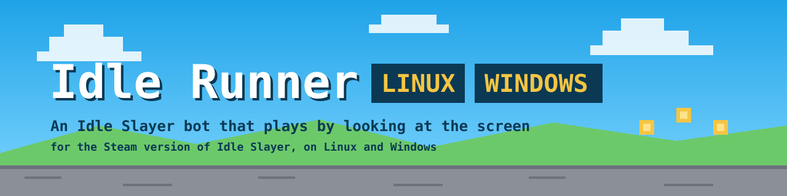
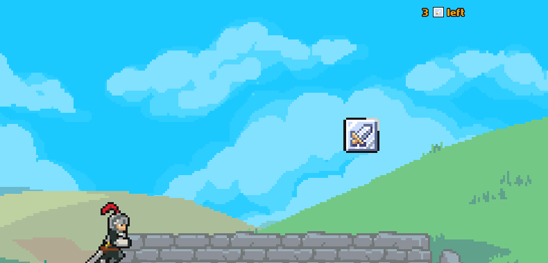
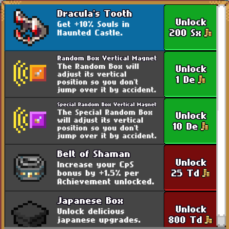
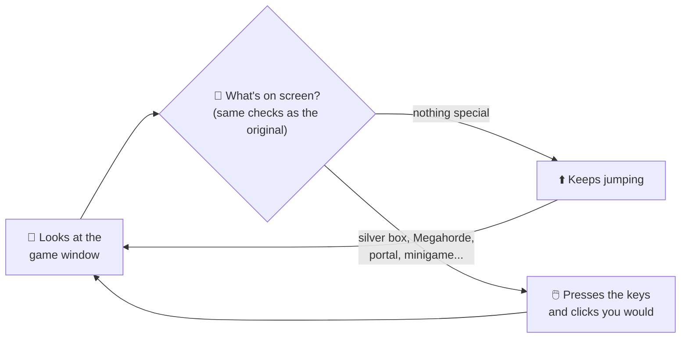

<p align="center">
  
</p>

<p align="center">
  <a href="LICENSE"></a>
  
  
  <a href="https://github.com/Devil4ngle/Idle_Slayer_Script"></a>
</p>

**Idle Runner for Linux** plays [Idle Slayer](https://store.steampowered.com/app/1353300/Idle_Slayer/) for you on Linux. It jumps, collects boxes, buys upgrades and plays the minigames.

It only **looks at the game window and presses keys**, the same way you would. It never touches the game's memory, files or saves.

> [!NOTE]
> **All credit for the idea goes to [Devil4ngle](https://github.com/Devil4ngle).** The original [Idle Runner](https://github.com/Devil4ngle/Idle_Slayer_Script) is a Windows AutoIt script, and every coordinate, colour and timing in this project comes from it. This port brings it to Linux and fixes a few things along the way. If it saves you time, consider [buying Devil4ngle a coffee](https://www.buymeacoffee.com/devil4ngle) ☕

<p align="center">
  
  
</p>

## ✨ What it does

| | |
|---|---|
| 🏃 **Runs** | Jumps and boosts nonstop, at the rate you choose. |
| 🎁 **Collects** | Silver boxes, minions and the daily bonus. |
| 🛒 **Buys** | Upgrades and equipment every few minutes, and claims quest rewards. |
| 🌀 **Travels** | Takes portals, cycling through the zones if you want. |
| 😡 **Rages** | Uses rage at Megahordes, optionally only with Soul Bonus. |
| 🎮 **Plays minigames** | Chest hunts, bonus stages, Ascending Heights and the Victor boss fight. |
| ⬆️ **Ascends** | Optional, on a timer. |

## 🚀 What's new compared to the original

The original script is excellent. Moving it to Linux was a good opportunity to fix a few things:

| | Original (Windows) | This port (Linux) |
|---|---|---|
| 👀 **Always watching** | Paused 2 seconds out of every 5, so 40% of the time it couldn't see Megahordes, chest hunts, quests or silver boxes. | The pause is gone, so it doesn't miss them. |
| 🛡️ **Safe ascending** | Since the game added the **Ultra Ascend** button, the confirm click can land on it. | Clicks a safe spot, and only once the "Are you sure?" dialog is up. |
| 🎯 **Easy to control** | Global hotkeys, and it grabs the game window's focus. | Plays while the game is focused. Switch windows to pause it, come back to resume. |
| 🔧 **Never gets stuck** | A screen that never shows up can leave it waiting forever. | Logs the problem with a screenshot and carries on. After 5 errors in a row it stops safely. |
| 📼 **Black box** | No record of what happened while you were away. | Keeps the last hour of gameplay. Press **Mark problem** and that moment is saved for good. |
| ⚡ **After ascending** | Waits the full buying interval before buying again. | Buys within 15 seconds, then slows down gradually. |
| 📐 **Window check** | Assumes the window is 1280x720. | Pauses with a warning until the size is right again. |
| 🧪 **Automated tests** | — | Over 150 tests, some replaying real game screenshots. |

<details>
<summary>Every difference, in detail</summary>

- The original slept 2 s every 5 s before closing popups, which blinded the fast checks (Megahordes, chest hunts, quests, silver boxes) 40% of the time. That sleep is gone.
- No focus stealing and no global hotkeys: focus = run, alt-tab = pause, Ctrl+C = stop. Closing the terminal or `kill` also stops it cleanly, and held keys are released (a long key hold ends as soon as the game loses focus).
- The bot pauses, with a warning, while the game window isn't exactly 1280x720 (checked continuously, e.g. if the window gets maximized).
- An unexpected error is logged with its traceback and the bot keeps going; it stops after 5 errors in a row.
- Bonus-stage sync markers that never show up are logged as `Sync timeout` events with a screenshot.
- One-shot crafts (Dimensional/Bidimensional staff) apply once per run. The portal rotation restarts from `circle_portals_count`.
- Loops that could hang forever give up after a timeout and log a `stuck` event with a screenshot.
- The jumper pauses immediately when a menu routine starts.
- Fixed: the Ascending Heights right-edge clamp, chest-hunt stats, and clicks outside the window (refused).
- Auto-ascend confirms at (598, 581) instead of (550, 580), and only once the "Are you sure?" dialog shows. Since the Ultra Ascension node is bought, (550, 580) is on the Ultra Ascend button whenever the dialog is late.
- Upgrades: blue event-quest rows are skipped only while their button is the grey "Quest Reward"; once claimed they get a buy button and are bought.
- The Knight boss stays disabled, as in the original.
- After an ascension, buying restarts quickly (`post_ascend_first_buy_seconds`, default 15 s) and the wait doubles up to `auto_buy_minutes`. Set it to 0 for the original behaviour.

</details>

## 🧠 How it works



## 📦 Install

You need the **Steam version of Idle Slayer for Linux** and Python 3.12 or newer (most recent distributions include it).

**1. Download the bot.** Get the latest version from [Releases](../../releases) and unzip it, or clone it:

```bash
git clone https://github.com/santiguti/idle-runner-linux.git
cd idle-runner-linux
```

**2. Install it** (once):

```bash
python3 -m venv .venv
.venv/bin/pip install -e .
```

**3. Set up the game** (the same settings the original needs):
- Windowed, **1280x720**, in **English**.
- Keybinds: jump = **Up arrow**, boost = **Right arrow**.
- Disable the custom cursor and the portal dialogue.
- Enable *rounded bulk* and *hide locked quest rewards*.
- Don't buy the **Vertical Magnet**.

**4. Start it:**

```bash
.venv/bin/python -m idle_runner gui
```

Press **Start**, then click on the game. The bot only plays while the game window is focused: switch to another window to pause it, and click the game again to resume.

> [!WARNING]
> **Auto-ascend is off by default, and ascending can't be undone.** Turn it on only if you want the bot to ascend on a timer.

<details>
<summary>The game boots to a black screen?</summary>

Steam's runtime is missing a library the game needs. In Steam, open Idle Slayer's **Properties → Launch options** and paste this (adjust the path to your Steam library):

```
"<steam library>/steamapps/common/Idle Slayer/Idle Slayer.x86_64" # %command%
```

Also make sure the game uses X11/XWayland: `~/.config/unity3d/Pablo Leban/Idle Slayer/Player.log` should say `Selected window backend: x11`. Don't launch it with `-force-wayland`.

</details>

<details>
<summary>KDE asks for "remote control" permission?</summary>

The first time the bot presses a key, KDE Plasma on Wayland asks whether to allow it. Accept, then click on the game again.

</details>

## ⚙️ Settings

Every setting is in the bot's window. You can also copy `config.example.toml` to `config.toml` and edit it. Each line is explained in the file.

---

<details>
<summary><b>🛠️ For developers</b>: terminal use, logs, calibration and tests</summary>

### Setup and tests
```bash
python3 -m venv .venv
.venv/bin/pip install -e '.[dev]'
.venv/bin/python -m pytest
```

### Running from a terminal
```bash
cp config.example.toml config.toml   # then edit it
.venv/bin/python -m idle_runner run
```
The bot only sends input while the Idle Slayer window is focused. Alt-tab away to pause it and focus the game again to resume. Stop it with Ctrl+C in the terminal (or Stop in the window). Saving from the window rewrites `config.toml` without comments; `config.example.toml` keeps them.

### Calibration and debugging: `probe`
```bash
.venv/bin/python -m idle_runner probe                     # window info, grab timings, probe.png
.venv/bin/python -m idle_runner probe --find 830399       # where is this exact colour?
.venv/bin/python -m idle_runner probe --pixel 640 360     # colour at a client pixel
.venv/bin/python -m idle_runner probe --delay 3 --key Up  # input test (focus the game within 3 s)
```

Measured on the development machine (2026-10-21):
- Window: 1280x720 client area, frame offset (8, 31), colour tolerance needed: 0. Verified with the portal button pixel (AutoIt (1180, 166) is exactly `0x830399`) and the chest-hunt grid (the saver bracket sits exactly on the AutoIt cell coordinates).
- Grab timings: 1 px 0.23 ms, full frame 5.1 ms.

### Logs
- `logs/idle_runner.log`: human-readable, millisecond timestamps. With `log_level = "DEBUG"` it also traces every pixel search.
- `logs/events.jsonl`: one JSON object per event (`ts`, `event`, extra fields), for analysis.
- `logs/frames/`: PNG screenshots at minigame start/end, safety-net timeouts (`stuck-*`) and crashes (`crash-*`).
- `.venv/bin/python -m idle_runner stats`: event counts and routine durations.
- `logs/blackbox/`: the black box. While the bot runs, a separate process saves the game window `blackbox_fps` times a second (default 4, about 100 KB a frame) and keeps the last `blackbox_minutes` (default 60, about 1.4 GB).
- `logs/marks/<time>-<why>/`: frames kept for good, with a `note.txt`:
  - by the black box itself around every anomaly the bot logs (a minute before to 30 s after; see `ANOMALIES` in `idle_runner/blackbox.py`);
  - by **Mark problem** in the window, or `.venv/bin/python -m idle_runner mark "what you saw"`: the last 5 minutes. Mark as soon as you notice something.

  The frames are hard links, so a mark costs no extra space until the black box prunes its copy. Delete old marks by hand.
- `.venv/bin/python -m idle_runner blackbox`: only the black box, e.g. while you play by hand.
- Every click, wheel notch and key hold the bot sends is in `idle_runner.log` (not on the console). The jumper's taps are only there at `log_level = "DEBUG"`.

</details>

## 🙏 Credits

- **[Devil4ngle](https://github.com/Devil4ngle)** created the original [Idle Runner](https://github.com/Devil4ngle/Idle_Slayer_Script). Its logic, coordinates and timings are the foundation of this port. For help and to meet other players, join the [Idle Slayer Scripting Discord](https://discord.gg/aEaBr77UDn).
- **Idle Slayer** is made by Pablo Leban. This project isn't affiliated with or endorsed by the game or its developer. Use it at your own risk.

Released under the [MIT license](LICENSE), like the original.
