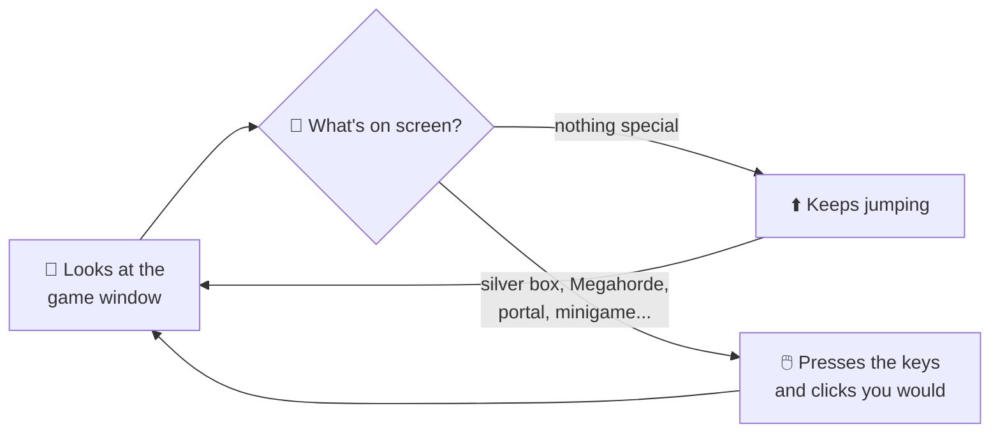

<p align="center">
  
</p>

<p align="center">
  <a href="LICENSE"></a>
  
  
</p>

# Idle Runner

**An Idle Slayer bot for Linux and Windows** (Windows is in beta). It plays [Idle Slayer](https://store.steampowered.com/app/1353300/Idle_Slayer/) for you. It jumps, collects boxes, buys upgrades, plays the minigames, ascends when it's worth it and spends your Slayer Points on the Ascension Tree.

It only **looks at the game window and presses keys**, the same way you would. It never touches the game's memory, files or saves.

**[⬇️ Download for Linux or Windows](https://santiguti.github.io/idle-slayer-bot/)** (or grab the files from [Releases](../../releases))

<p align="center">
  
</p>

<p align="center">
  
  
</p>

## ✨ What it does

| | |
|---|---|
| 🏃 **Runs** | Jumps and boosts nonstop, at the rate you choose. |
| 🎁 **Collects** | Silver and orange boxes, and two extra Daily Quests every day. Sends your minions on their missions. |
| 🛒 **Buys** | Upgrades and equipment every few minutes, and claims quest rewards. Right after an ascension it buys as soon as you have 6 coins, then slows down gradually. |
| 🌀 **Travels** | Takes portals, cycling through the zones if you want. |
| 😡 **Rages** | Uses rage at Megahordes, optionally only with Soul Bonus. |
| 🎮 **Plays minigames** | Chest hunts, Bonus Stages 2 and 3, Ascending Heights and the Victor boss fight. |
| ⬆️ **Ascends** | Optional. On a timer, or as soon as the Ascend button's **"+X% CpS bonus"** reaches the percentage you set. |
| 🌳 **Spends SP** | Optional. Buys Ascension Tree nodes in your order, at start and after every ascension. *New, still being tested.* |

## 🔒 Safety

- It only reads pixels from the game window and sends keys and mouse clicks. It never reads or changes the game's memory, files or network traffic.
- It never spends jewels (they cost real money): it presses Buy in the Ascension Tree only when the game shows enough Slayer Points, and closes any jewel offer.
- It never Ultra Ascends.
- Ascending and tree buying are off until you turn them on.

## 📦 Install

On Linux you need the **Steam version of Idle Slayer for Linux**. On Windows, see *Windows* below.

**1. Install it.** The easiest way: download `IdleRunner-…-linux-x64.tar.gz` from [Releases](../../releases), extract it and run `./install.sh` inside the `IdleRunner` folder. That adds *Idle Runner* to your application menu (no Python needed; Ubuntu 22.04 / Fedora 36 or newer).

Or, with Python 3.12 or newer and [pipx](https://pipx.pypa.io/):

```bash
pipx install git+https://github.com/santiguti/idle-slayer-bot
idle-runner            # opens the window
```

Or from a clone, in a virtual environment:

```bash
git clone https://github.com/santiguti/idle-slayer-bot.git
cd idle-slayer-bot
python3 -m venv .venv
.venv/bin/pip install -e .
```

**2. Set up the game:**
- Windowed, **1280x720**, in **English**.
- Keybinds: jump = **Up arrow**, boost = **Right arrow**.
- Disable the custom cursor and the portal dialogue.
- Enable *rounded bulk* and *hide locked quest rewards*.
- Don't buy the **Vertical Magnet**.

**3. Start it:** `idle-runner` (or `.venv/bin/python -m idle_runner`) opens the window.

Press **Start**, then click on the game. The bot only plays while the game window is focused: switch to another window to pause it, and click the game again to resume. The window shows:

- **Dashboard:** what the bot is doing, whether the game is found at the right size, this run's numbers and the latest events.
- **Settings:** every option in plain words, saved as you change it.
- **Tree order:** which Ascension Tree nodes the bot buys, and in what order. Drag them, add or remove them, or go back to the recommended order.
- **Activity:** everything the bot did, filtered by purchases, ascensions, minigames or problems.
- **Help:** the game setup above, what the bot never does, and links.

<details>
<summary>Windows</summary>

The Windows version is tested automatically, but it's still a beta until more people run it with the real game. Please [report how it goes](../../issues/new/choose).

Download `IdleRunner-…-windows-x64.zip` from [Releases](../../releases), unzip it anywhere and double-click `IdleRunner.exe`. The exe isn't code-signed, so SmartScreen may say "Windows protected your PC": choose **More info → Run anyway**.

Or run it from source in PowerShell (Python 3.12 or newer):

```powershell
git clone https://github.com/santiguti/idle-slayer-bot.git
cd idle-slayer-bot
py -m venv .venv
.venv\Scripts\pip install -e .
.venv\Scripts\idle-runner
```

</details>

> [!WARNING]
> **Auto-ascend and tree buying are off by default, and neither can be undone.** Ascending resets your run, and tree nodes spend your SP. Turn them on only if you want the bot to do it for you.

<details>
<summary>The game boots to a black screen?</summary>

Steam's runtime is missing a library the game needs. In Steam, open Idle Slayer's **Properties → Launch options** and paste this (adjust the path to your Steam library):

```
"<steam library>/steamapps/common/Idle Slayer/Idle Slayer.x86_64" # %command%
```

Also make sure the game uses X11/XWayland: `~/.config/unity3d/Pablo Leban/Idle Slayer/Player.log` should say `Selected window backend: x11`. Don't launch it with `-force-wayland`.

</details>

<details>
<summary>KDE asks for "remote control" permission?</summary>

The first time the bot presses a key, KDE Plasma on Wayland asks whether to allow it. Accept, then click on the game again.

</details>

## 🛡️ Built to run unattended

| | |
|---|---|
| 👀 **Always watching** | Checks for Megahordes, chest hunts, quests and silver boxes all the time, with no blind spots. |
| 🎯 **Easy to control** | Plays while the game is focused. Switch windows to pause it, come back to resume. No hotkeys, no focus stealing. |
| 🛡️ **Safe ascending** | Never clicks the **Ultra Ascend** button: it confirms on a safe spot, and only once the "Are you sure?" dialog is up. It never Ultra Ascends. |
| ♻️ **Ultra Ascension aware** | Handles the game after an Ultra Ascension: a shop without the Quests tab, no Minions tab, a single Ascend button. |
| 🔧 **Never gets stuck** | A screen that never shows up is logged with a screenshot and skipped. After 5 errors in a row it stops safely. |
| 📼 **Black box** | Keeps the last hour of gameplay. Press **Mark problem** and that moment is saved for good. |
| 📐 **Window check** | Pauses with a warning while the window isn't 1280x720. |
| 🧪 **Automated tests** | Over 200 tests, many replaying real game screenshots. |

<details>
<summary>All the details</summary>

- Focus = run, alt-tab = pause, Ctrl+C = stop. Closing the terminal or `kill` also stops it cleanly, and held keys are released (a long key hold ends as soon as the game loses focus).
- The window size is checked continuously (e.g. if the window gets maximized).
- An unexpected error is logged with its traceback and the bot keeps going; it stops after 5 errors in a row. Loops that could hang forever give up after a timeout and log a `stuck` event with a screenshot.
- The jumper pauses as soon as a menu routine starts.
- Clicks outside the game window are refused.
- **Shop:** every tab click is checked before buying, so a click meant for one tab can't land on another (e.g. "Max" in Equipment is "Buy all available" in Upgrades). If the shop doesn't open (e.g. a minigame's results screen still covers it), it tries again 15 s later. The shop is closed only while it shows, and the bot waits for it to finish closing: a second click while it closes leaves an empty panel that blocks every later click.
- **Quests:** blue event-quest rows are skipped while their button is the grey "Quest Reward", and bought once claimed. Without a Quests tab (after an Ultra Ascension, until quests are unlocked again) it doesn't claim, so it never opens the Jewels shop by mistake.
- **Random Box:** if a silver or orange box shows up while shopping or claiming quests, the bot stops, lets the jumper grab it and buys again shortly after.
- **After an ascension:** the coin counter is read, and the bot buys as soon as it shows 6 coins (the sword's first level), by the bot's ascension or yours. Then buying restarts at `post_ascend_first_buy_seconds` (default 15 s) and the wait doubles up to `auto_buy_minutes`.
- **Ascend by %:** every `ascend_bonus_sample_minutes` the bot opens the Ascension tab and reads the button's "+X% CpS bonus" (SP gained by ascending ÷ SP earned so far). With `auto_ascend_percent` set, it ascends at the first reading that reaches it; `auto_ascend_minutes` stays as the cap. A bonus it can't read is logged with a screenshot, never guessed.
- **Ascension Tree:** with `auto_buy_tree`, the bot zooms the tree all the way out (where every node has a fixed place), then clicks the nodes in the order of `tree_order` (see Settings). Bought nodes are skipped; it stops at the first node it can't buy. It runs at start, after each ascension by the bot, and after one by hand. Restart the bot after an Ultra Ascension by hand.
- **Minions:** at start, after each tree run and every 30 minutes the bot claims the minions back from their missions and sends every minion whose mission your unspent SP covers. It reads the mission's cost on the button and your SP in the header first, so the game never gets to offer jewels for the rest.
- **Bonus Stage 1** (while the tree's "Bonus Stage 2" node isn't bought) is skipped: the bot lets its first section run out and closes it.
- One-shot crafts (Dimensional/Bidimensional staff) apply once per run. The portal rotation restarts from `circle_portals_count`.
- Bonus-stage sync markers that never show up are logged as `Sync timeout` events with a screenshot.
- The Knight boss fight is disabled.

</details>

## 🧠 How it works



## ⚙️ Settings

Every setting is in the window's Settings page, with what it does. You can also copy `config.example.toml` to `config.toml` and edit it. Each line is explained in the file.

<p align="center">
  
  
</p>

To ascend by percentage, set both `ascend_bonus_sample_minutes` (how often the bonus is read, e.g. 5) and `auto_ascend_percent`. To change which tree nodes are bought, and in what order, list them under `tree_order` in the `[tree]` section of `config.toml` (every valid name is in [`idle_runner/tree_nodes.py`](idle_runner/tree_nodes.py)). Without it, the bot uses the recommended order.

---

<details>
<summary><b>🛠️ For developers</b>: terminal use, logs, calibration and tests</summary>

### Setup and tests
```bash
python3 -m venv .venv
.venv/bin/pip install -e '.[dev]'
.venv/bin/python -m pytest
```

### Running from a terminal
```bash
cp config.example.toml config.toml   # then edit it
.venv/bin/python -m idle_runner run
```
The bot only sends input while the Idle Slayer window is focused. Alt-tab away to pause it and focus the game again to resume. Stop it with Ctrl+C in the terminal (or Stop in the window). Saving from the window rewrites `config.toml` without comments; `config.example.toml` keeps them.

### Calibration and debugging: `probe`
```bash
.venv/bin/python -m idle_runner probe                     # window info, grab timings, probe.png
.venv/bin/python -m idle_runner probe --find 830399       # where is this exact colour?
.venv/bin/python -m idle_runner probe --pixel 640 360     # colour at a client pixel
.venv/bin/python -m idle_runner probe --delay 3 --key Up  # input test (focus the game within 3 s)
```

Coordinates in the code are in the original AutoIt script's frame (window including the Windows title bar); `Game` subtracts the offset (8, 31). Measured on the development machine (2026-10-21):
- Window: 1280x720 client area, frame offset (8, 31), colour tolerance needed: 0. Verified with the portal button pixel (AutoIt (1180, 166) is exactly `0x830399`) and the chest-hunt grid.
- Grab timings: 1 px 0.23 ms, full frame 5.1 ms.

### Logs
- `logs/idle_runner.log`: human-readable, millisecond timestamps. With `log_level = "DEBUG"` it also traces every pixel search.
- `logs/events.jsonl`: one JSON object per event (`ts`, `event`, extra fields), for analysis. Ascend-bonus readings are `Ascend bonus` events with a `percent` field.
- `logs/frames/`: PNG screenshots at minigame start/end, safety-net timeouts (`stuck-*`), crashes (`crash-*`), unreadable ascend bonuses and tree nodes that weren't bought.
- `.venv/bin/python -m idle_runner stats`: event counts and routine durations.
- `logs/blackbox/`: the black box. While the bot runs, a separate process saves the game window `blackbox_fps` times a second (default 4, about 100 KB a frame) and keeps the last `blackbox_minutes` (default 60, about 1.4 GB).
- `logs/marks/<time>-<why>/`: frames kept for good, with a `note.txt`:
  - by the black box itself around every anomaly the bot logs (a minute before to 30 s after; see `ANOMALIES` in `idle_runner/blackbox.py`);
  - by **Mark problem** in the window, or `.venv/bin/python -m idle_runner mark "what you saw"`: the last 5 minutes. Mark as soon as you notice something.

  The frames are hard links, so a mark costs no extra space until the black box prunes its copy. Delete old marks by hand.
- `.venv/bin/python -m idle_runner blackbox`: only the black box, e.g. while you play by hand.
- Every click, wheel notch and key hold the bot sends is in `idle_runner.log` (not on the console). The jumper's taps are only there at `log_level = "DEBUG"`.

</details>

## 💛 Support

Idle Runner is free and always will be. If it saves you some clicks and you'd like to say thanks, you can [buy me a coffee on Ko-fi](https://ko-fi.com/santiguti). Bug reports and ideas in [Issues](../../issues) help just as much.

## 🙏 Credits

- This project started as a Linux port of [Devil4ngle](https://github.com/Devil4ngle)'s [Idle Runner](https://github.com/Devil4ngle/Idle_Slayer_Script), a Windows AutoIt script. Its detection logic, coordinates and timings are still the base of the bot.
- **Idle Slayer** is made by Pablo Leban. This project isn't affiliated with or endorsed by the game or its developer. Use it at your own risk.

Released under the [MIT license](LICENSE).
